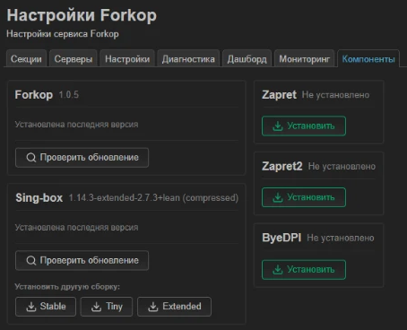

# sing-box-extended lean

A lightweight build of [sing-box-extended](https://github.com/shtorm-7/sing-box-extended) with XHTTP
for [Forkop](https://github.com/ushan0v/forkop) on OpenWrt routers.

[Русский](README.ru.md)



## Features

- Protocols: VLESS, VMess, Trojan, Shadowsocks, SOCKS, HTTP and Hysteria2.
- Transports: XHTTP, WebSocket, gRPC, HTTPUpgrade and HTTP, with TLS, Reality and uTLS.
- The binary is ~26 MB instead of ~93 MB. It is not UPX-packed, so it is read from flash
  instead of being unpacked into RAM.
- On a router with 256 MB RAM, about 103 MB stays free (vs ~12 MB with Extended compressed).
- Go memory soft limit of 64 MB.
- The installer checks your Forkop config first and rolls back on its own if the new build
  fails to start.
- New upstream releases are rebuilt and tested automatically.

## Installation

You need an OpenWrt router on aarch64 (for example MT7981) with Forkop installed.
Run on the router:

```sh
sh <(wget -O - https://raw.githubusercontent.com/Hxrmfull/sing-box-extended/lean/install-lean.sh)
```

Binaries are also on the [Releases](https://github.com/Hxrmfull/sing-box-extended/releases) page:
`sing-box-lean-linux-arm64` is the one for the router.

## Usage

After installation, Forkop runs the build as usual. On the Components tab it shows as
`…+lean (compressed)`.

| Action | How |
|---|---|
| Update | Run the install command again |
| Roll back | Forkop → Components → Stable |
| Check the version | `sing-box version` |

Do not update sing-box from Forkop or press Extended there: that installs the heavy compressed build.

## Building

```sh
git clone --depth 1 --branch v1.14.3-extended-2.7.3 https://github.com/shtorm-7/sing-box-extended upstream
sh lean/apply.sh upstream
cd upstream && LEAN_BASE_VERSION=1.14.3-extended-2.7.3 sh build-lean.sh arm64
```

You need the Go version from upstream `go.mod`. The binary is written to `upstream/dist/`.

## License

GPL-3.0, same as sing-box-extended.
